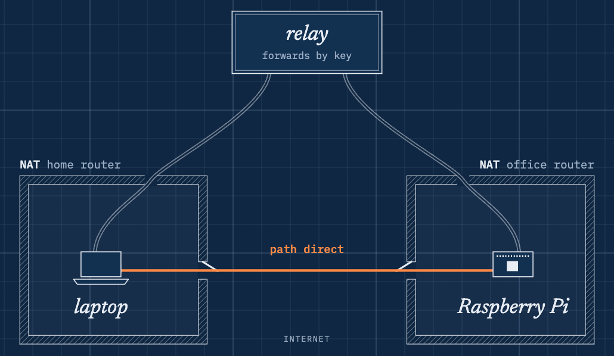

# natty

[natty](https://razvandimescu.github.io/natty/) connects two applications behind NAT. It requires no signup mechanism and it's working similarly with how ssh works, by using a private / public key. The receiver application has a list of pre authorized keys that are allowed to access it.

[](https://razvandimescu.github.io/natty/)

There are 3 entities required so that this works:

- [The library](docs/library.md) gives a Rust application a connection to a peer key.
- [The `natty` CLI](#share-a-tcp-service) shares a TCP service with the keys that you list.
- [The relay server](#run-a-relay) helps the peers open a direct UDP path through their NATs (hole punching). If the punch does not succeed, the relay forwards the encrypted packets.

## Share a TCP service

Install the CLI on both machines using Homebrew, cargo or one of the [released binaries](https://github.com/razvandimescu/natty/releases) for Linux, macOS and Windows:

```sh
brew install razvandimescu/tap/natty
# or
cargo install natty --features cli
```

Each machine keeps its key in the file that `NATTY_KEY` names. natty makes the file on first use.

These steps use the test relay `relay.numa.rs`. Do not use it for a service that you depend on. The author of natty runs it for the friend-to-friend feature of [numa](https://github.com/razvandimescu/numa). It can stop or change at any time. It shares a traffic cap with numa users.

1. On the machine that connects, print its public key:
   ```sh
   export NATTY_KEY="$HOME/.natty/key"
   natty key
   ```
2. On the machine with the service, write the grants file. Each line holds one key and then its services:
   ```sh
   echo '<key from step 1> web' > grants
   ```
3. On the same machine, start the agent. This example shares a web server on port 8000:
   ```sh
   export NATTY_KEY="$HOME/.natty/key"
   natty serve relay.numa.rs --grants grants --service web=127.0.0.1:8000
   ```
   The agent prints `serving as <key>@relay.numa.rs`.
4. On the first machine, in the shell of step 1, give the service a local port. Use the address that the agent printed:
   ```sh
   natty connect '<key>@relay.numa.rs' web --port 8080
   ```
   The command prints `127.0.0.1:8080 -> web`.

Result: `curl http://127.0.0.1:8080/` on the first machine gets the answer of the web server.

[docs/cli.md](docs/cli.md) describes the path of the connection, the grants file, a second service and the container image.

## Run a relay

A relay needs a TLS certificate for its host name or IP address, a TCP port for sessions and a UDP port for STUN. The defaults are TCP 443 and UDP 3478. The peers need only outbound access. The relay accepts a session from any key. [What the relay knows](docs/design.md#what-the-relay-knows) lists the data that its operator can see.

A pair of peers without a direct path sends all of its traffic through the relay. To limit the load, use `--cap`, `--total-cap` and `--per-ip`.

To install the relay, run `cargo install natty-relay`. The image `ghcr.io/razvandimescu/natty-relay:v0.0.4` holds the relay for linux/amd64. It takes the same flags. [relay/README.md](relay/README.md) describes the certificate setup, the health check and the flags.

## How it works

Peers authenticate with raw Ed25519 public keys in TLS 1.3 (RFC 7250). The dialer accepts only the key that it dialed. The listener accepts any key. The application decides what that key can do.

The design follows Tailscale's DERP with its own framing. natty is not compatible with DERP. [docs/design.md](docs/design.md) specifies the wire format. [docs/research.md](docs/research.md) gives the design decisions with sources.

[An animated walk-through](https://razvandimescu.github.io/natty/how-it-works.html) shows how natty finds a path to a peer.

## Limits

- There is no port mapping (NAT-PMP, PCP). [ROADMAP.md](ROADMAP.md) has it as phase 4.
- An endpoint uses one relay. It has no failover. To reach a peer on a different
  relay, bind a second endpoint on that relay.
- A relay keeps one session for each key. A second process with the same key replaces the session of the first.
- There is no port prediction for hard NATs.
- Local candidates come only from the interface of the default route.
- Openers are IPv4 only.
- There is no declared minimum Rust version.
- natty has no security review yet. To report a vulnerability, see [SECURITY.md](SECURITY.md).


## License

natty is available under the [Apache License 2.0](LICENSE-APACHE) or the
[MIT license](LICENSE-MIT), at your option.

Unless you explicitly state otherwise, any contribution intentionally submitted
for inclusion in the work by you, as defined in the Apache-2.0 license, shall be
dual licensed as above, without any additional terms or conditions.
